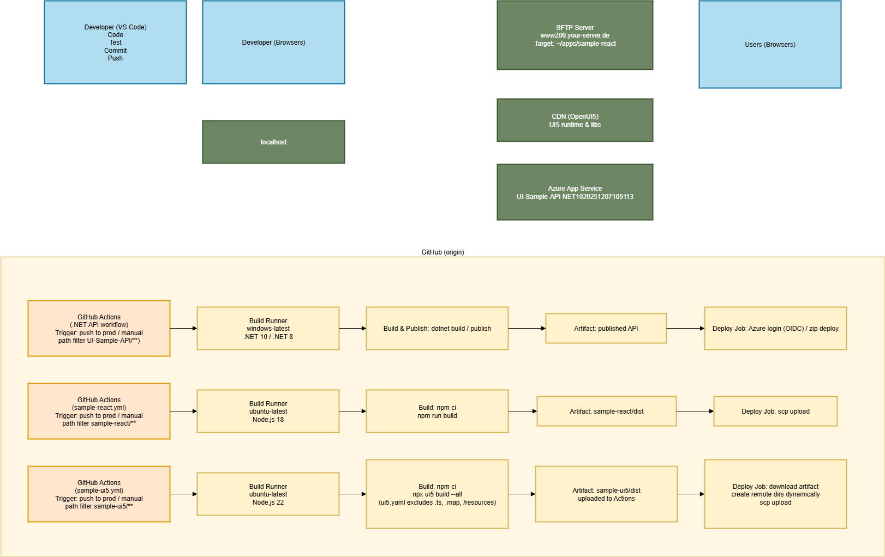

# UI Samples

This repository contains sample applications and APIs for various frontend frameworks and .NET backends. Each directory demonstrates a different technology stack, with minimal setup and cross-framework patterns.

## Directory Overview

- **sample-angular/**: Angular 17+ sample app (TypeScript, RxJS, Angular CLI) — [Angular Notes](docs/README-ang.md)
- **sample-react/**: React 18+ sample app (Vite, TypeScript, React Router, Chart.js) — [React Notes](docs/README-REACT-APP.md)
- **sample-ui5/**: SAPUI5/OpenUI5 sample app (TypeScript, UI5 CLI, QUnit) — [UI5 Notes](docs/README-UI5.md)
- **sample-vue/**: Vue 3 sample app (Vite, TypeScript, Composition API) — [Vue Notes](docs/README-VUE.md)
- **UI-Sample-API-NET10/**: .NET 10 Web API (C#, minimal API, NodaTime, Scalar)
- **UI-Sample-API-NET8/**: .NET 8 Web API (C#, minimal API)
- **UI-Sample-API.Shared/**: Shared C# code (models, controllers) for .NET APIs
- **docs/**: Documentation, deployment notes, and overview images

---


## Sample Apps Overview



---

## Quickstart: Debugging the Apps

Each sample app can be debugged locally using the standard tooling for its framework. Below are the basics for each:

### Angular
- Open `sample-angular` in VS Code.
- Run `npm install`.
- Start the dev server: `npm start` or `ng serve`.
- Use the VS Code debugger (F5) or browser DevTools.

### React
- Open `sample-react` in VS Code.
- Run `npm install`.
- Start the dev server: `npm start` or `npm run dev`.
- Use the VS Code debugger (F5) or browser DevTools.

### Vue
- Open `sample-vue` in VS Code.
- Run `npm install`.
- Start the dev server: `npm start` or `npm run dev`.
- Use the VS Code debugger (F5) or browser DevTools.

### UI5
- Open `sample-ui5` in VS Code.
- Run `npm install`.
- Start the dev server: `npm start` or `ui5 serve`.
- Debug in Chrome/Edge DevTools (F12).

### .NET APIs
- Open `UI-Sample-API-NET10` or `UI-Sample-API-NET8` in VS Code or Visual Studio.
- Run with F5 (debug) or `dotnet run`.
- Set breakpoints in C# files.

---

## Technology Stack

**Frontend:**
- [SAPUI5 / OpenUI5](https://ui5.sap.com/) (UI5 app)
- [React](https://react.dev/) ([React Router](https://reactrouter.com/), [Chart.js](https://www.chartjs.org/), [react-chartjs-2](https://react-chartjs-2.js.org/))
- [Angular](https://angular.io/) ([RxJS](https://rxjs.dev/), [Angular CLI](https://angular.io/cli), [Angular Devkit](https://github.com/angular/angular-cli))
- [Vue 3](https://vuejs.org/) ([Vite](https://vitejs.dev/), [vue-tsc](https://github.com/johnsoncodehk/vue-tsc), [@vitejs/plugin-vue](https://github.com/vitejs/vite-plugin-vue))

**Backend:**
- [ASP.NET Core](https://learn.microsoft.com/aspnet/core) (.NET 8, .NET 10)
- [C#](https://learn.microsoft.com/dotnet/csharp/)
- [NodaTime](https://nodatime.org/) (date/time handling)
- [Scalar.AspNetCore](https://www.nuget.org/packages/Scalar.AspNetCore), [SolCalc](https://www.nuget.org/packages/SolCalc) (math/solar calculations)
- [Swashbuckle.AspNetCore](https://github.com/domaindrivendev/Swashbuckle.AspNetCore) (Swagger/OpenAPI)
- [Microsoft.AspNetCore.Authentication.JwtBearer](https://learn.microsoft.com/dotnet/api/microsoft.aspnetcore.authentication.jwtbearer), [Negotiate](https://learn.microsoft.com/dotnet/api/microsoft.aspnetcore.authentication.negotiate)

**Build Tools & Tooling:**
- [Vite](https://vitejs.dev/) (React, Vue)
- [UI5 CLI](https://sap.github.io/ui5-tooling/), [UI5 Tooling](https://sap.github.io/ui5-tooling/) (UI5)
- [TypeScript](https://www.typescriptlang.org/)
- [Babel](https://babeljs.io/) (for coverage)
- [ESLint](https://eslint.org/) (all projects)
- [rimraf](https://www.npmjs.com/package/rimraf) (cleanup)
- [npm-run-all2](https://www.npmjs.com/package/npm-run-all2) (Vue)
- [ts-node](https://typestrong.org/ts-node/), [vue-tsc](https://github.com/johnsoncodehk/vue-tsc)

**DevOps / Deployment:**
- [GitHub Actions](https://github.com/features/actions) (CI/CD)
- [SFTP](https://en.wikipedia.org/wiki/SSH_File_Transfer_Protocol) (for UI5/React deploy)
- [Azure App Service](https://azure.microsoft.com/products/app-service) (for .NET API)
- [sshpass](https://linux.die.net/man/1/sshpass), [scp](https://linux.die.net/man/1/scp) (for SFTP deploy)
- [OIDC](https://openid.net/connect/) (Azure login in GitHub Actions)

**Testing:**
- [QUnit](https://qunitjs.com/) (UI5)
- [UI5 Test Runner](https://github.com/ui5-community/ui5-test-runner)
- [WebdriverIO](https://webdriver.io/) (UI5 E2E)
- [Mocha](https://mochajs.org/) (via WebdriverIO)
- [ESLint](https://eslint.org/) for linting

**Other:**
- [Node.js](https://nodejs.org/) (various versions)
- [npm](https://www.npmjs.com/) (package management)
- [Git](https://git-scm.com/) (source control)
- [YAML](https://yaml.org/) (workflow configuration)
- [JSON](https://www.json.org/), [XML](https://www.w3.org/XML/) (project configs)

---

## Port Overview

| Framework/Technology | HTTP Port | HTTPS Port |
|----------------------|-----------|------------|
| .NET 6-10 (new)      | 5000-5999 | 7000-7999  |
| .NET Core (old)      | 5000      | 5001       |
| Angular CLI          | 4200      | -          |
| React (Vite)         | 5173      | -          |
| Vue.js               | 3000/8080 | -          |
| UI5                  | 8080      | -          |
| Node.js/Express      | 3000      | -          |
| IIS Express          | 5000+     | 44300+     |

---

## Notes & Setup Instructions

### UI5

- Install Yeoman and UI5 generator globally:
  ```sh
  npm install -g yo generator-easy-ui5
  ```
- Run Yeoman UI5 generator to scaffold app:
  ```sh
  yo easy-ui5 project
  yo easy-ui5 ts-app
  ```
- Install UI5 CLI:
  ```sh
  npm install -g @ui5/cli
  ```

### References

- [Swagger vs Scalar API Documentation](https://thedataguy.pro/blog/2025/08/swagger-vs-scalar-api-documentation/)

---

<!-- End of README -->

     _                      _                 ____ _     ___
    / \   _ __   __ _ _   _| | __ _ _ __     / ___| |   |_ _|
   / △ \ | '_ \ / _` | | | | |/ _` | '__|   | |   | |    | |
  / ___ \| | | | (_| | |_| | | (_| | |      | |___| |___ | |
 /_/   \_\_| |_|\__, |\__,_|_|\__,_|_|       \____|_____|___|
                |___/


Angular CLI       : 21.0.2
Node.js           : 24.10.0
Package Manager   : npm 11.6.1
Operating System  : win32 x64


Framework/Technologie	HTTP Port	HTTPS Port
.NET 6-10 (neu)	5000-5999	7000-7999
.NET Core (alt)	5000	5001
Angular CLI	4200	-
React (Vite)	5173	-
Vue.js	3000/8080	-
UI5	8080	-
Node.js/Express	3000	-
IIS Express	5000+	44300+


Port-Übersicht aller Frontend-Apps in Ihrem Projekt
Framework	Port	Konfiguration
Angular	4200	angular.json → architect.serve.options.port
React (Vite)	5173 (Standard)	vite.config.ts → server.port
UI5	8080	ui5.yaml oder npm scripts
Vue (Vite)	58256 (aktuell) → 3000 empfohlen	vite.config.ts → server.port

Vite Port-Unterschiede:
Befehl	Standard-Port	Zweck
npm run dev → vite	5173 (oder konfiguriert: 3000)	Development-Server mit Hot Reload
npm run preview → vite preview	4173	Preview der Production-Build


---

## Technology Stack

**Frontend:**
- [SAPUI5 / OpenUI5](https://ui5.sap.com/) (UI5 app)
- [React](https://react.dev/) ([React Router](https://reactrouter.com/), [Chart.js](https://www.chartjs.org/), [react-chartjs-2](https://react-chartjs-2.js.org/))
- [Angular](https://angular.io/) ([RxJS](https://rxjs.dev/), [Angular CLI](https://angular.io/cli), [Angular Devkit](https://github.com/angular/angular-cli))
- [Vue 3](https://vuejs.org/) ([Vite](https://vitejs.dev/), [vue-tsc](https://github.com/johnsoncodehk/vue-tsc), [@vitejs/plugin-vue](https://github.com/vitejs/vite-plugin-vue))

**Backend:**
- [ASP.NET Core](https://learn.microsoft.com/aspnet/core) (.NET 8, .NET 10)
- [C#](https://learn.microsoft.com/dotnet/csharp/)
- [NodaTime](https://nodatime.org/) (date/time handling)
- [Scalar.AspNetCore](https://www.nuget.org/packages/Scalar.AspNetCore), [SolCalc](https://www.nuget.org/packages/SolCalc) (math/solar calculations)
- [Swashbuckle.AspNetCore](https://github.com/domaindrivendev/Swashbuckle.AspNetCore) (Swagger/OpenAPI)
- [Microsoft.AspNetCore.Authentication.JwtBearer](https://learn.microsoft.com/dotnet/api/microsoft.aspnetcore.authentication.jwtbearer), [Negotiate](https://learn.microsoft.com/dotnet/api/microsoft.aspnetcore.authentication.negotiate)

**Build Tools & Tooling:**
- [Vite](https://vitejs.dev/) (React, Vue)
- [UI5 CLI](https://sap.github.io/ui5-tooling/), [UI5 Tooling](https://sap.github.io/ui5-tooling/) (UI5)
- [TypeScript](https://www.typescriptlang.org/)
- [Babel](https://babeljs.io/) (for coverage)
- [ESLint](https://eslint.org/) (all projects)
- [rimraf](https://www.npmjs.com/package/rimraf) (cleanup)
- [npm-run-all2](https://www.npmjs.com/package/npm-run-all2) (Vue)
- [ts-node](https://typestrong.org/ts-node/), [vue-tsc](https://github.com/johnsoncodehk/vue-tsc)


**DevOps / Deployment:**
- [GitHub Actions](https://github.com/features/actions) (CI/CD)
- [SFTP](https://en.wikipedia.org/wiki/SSH_File_Transfer_Protocol) (for UI5/React deploy)
- [Azure App Service](https://azure.microsoft.com/products/app-service) (for .NET API)
- [sshpass](https://linux.die.net/man/1/sshpass), [scp](https://linux.die.net/man/1/scp) (for SFTP deploy)
- [OIDC](https://openid.net/connect/) (Azure login in GitHub Actions)

**Testing:**
- [QUnit](https://qunitjs.com/) (UI5)
- [UI5 Test Runner](https://github.com/ui5-community/ui5-test-runner)
- [WebdriverIO](https://webdriver.io/) (UI5 E2E)
- [Mocha](https://mochajs.org/) (via WebdriverIO)
- [ESLint](https://eslint.org/) for linting

**Other:**
- [Node.js](https://nodejs.org/) (various versions)
- [npm](https://www.npmjs.com/) (package management)
- [Git](https://git-scm.com/) (source control)
- [YAML](https://yaml.org/) (workflow configuration)
- [JSON](https://www.json.org/), [XML](https://www.w3.org/XML/) (project configs)


